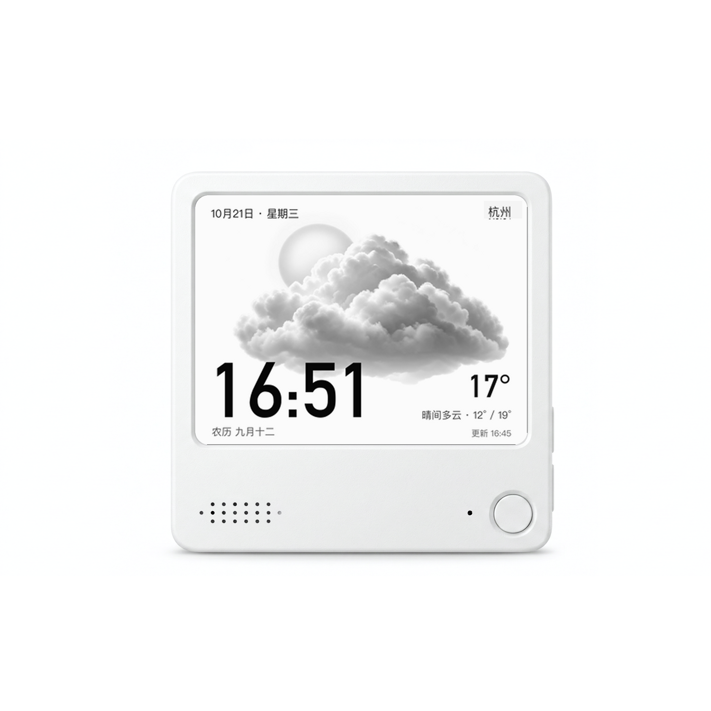
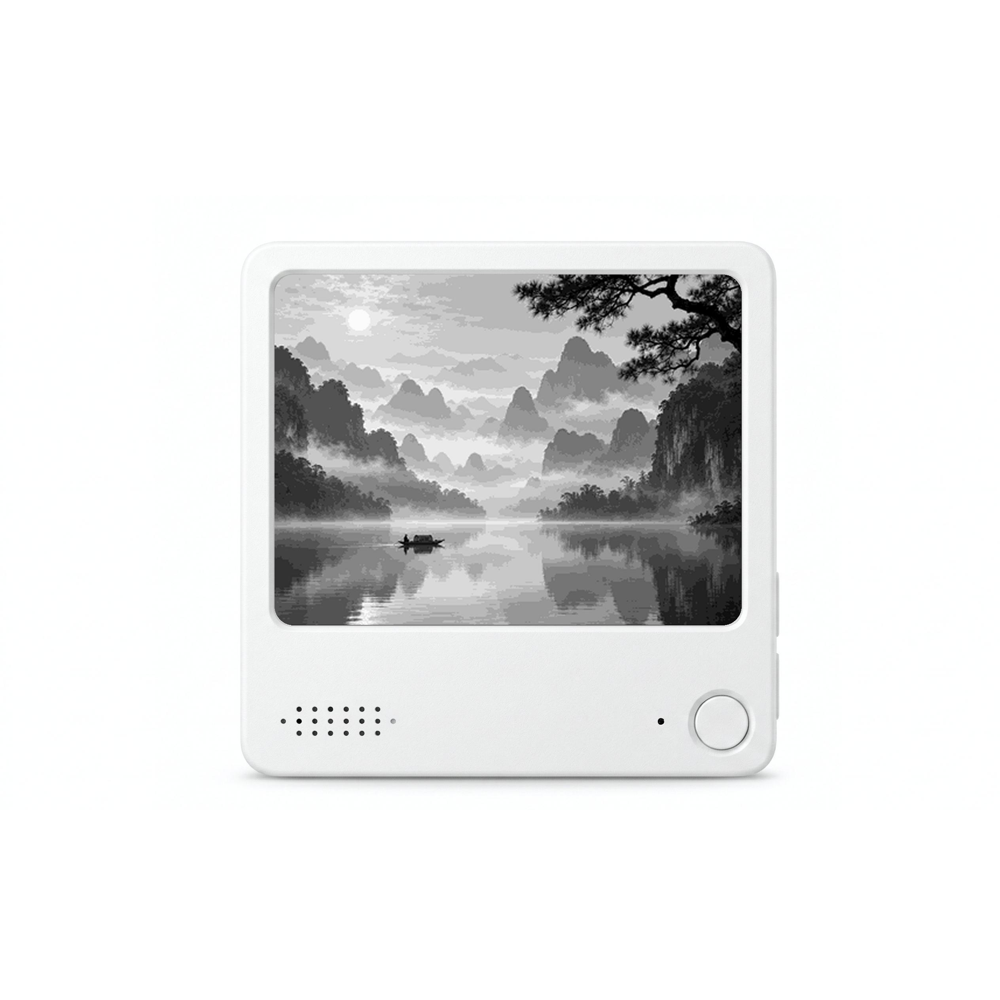
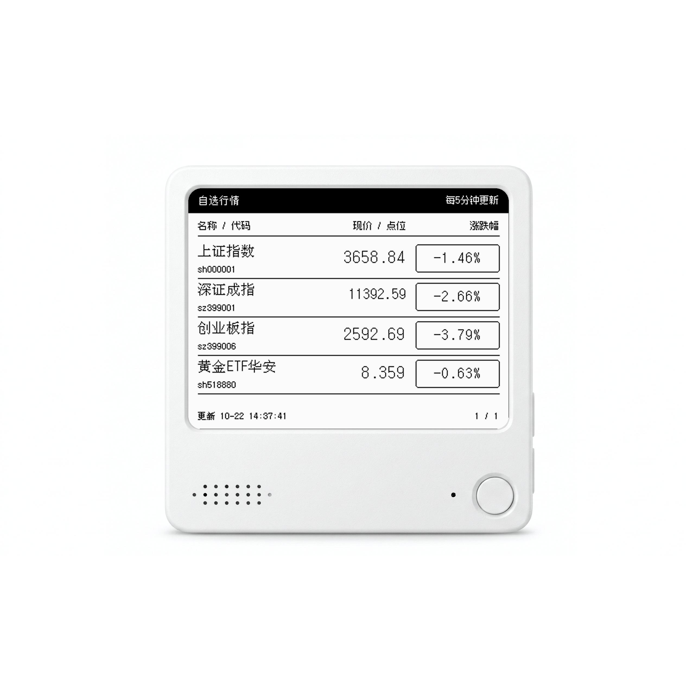
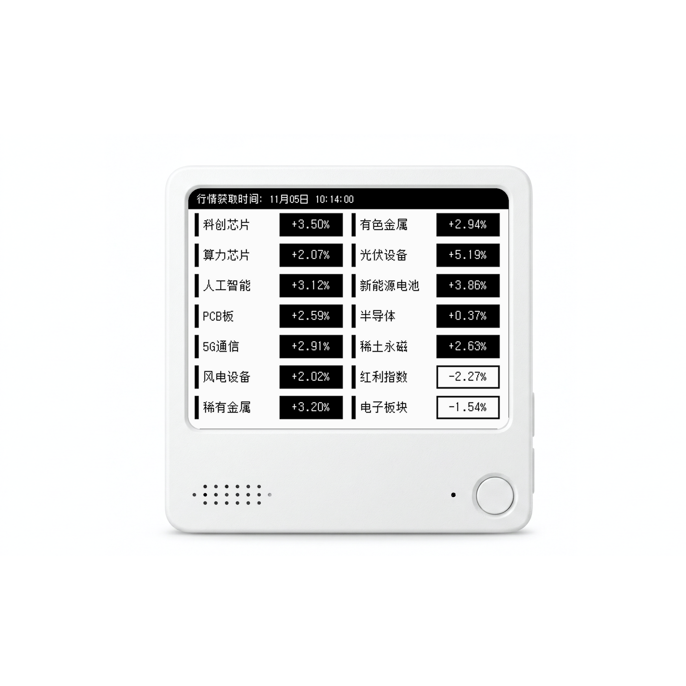
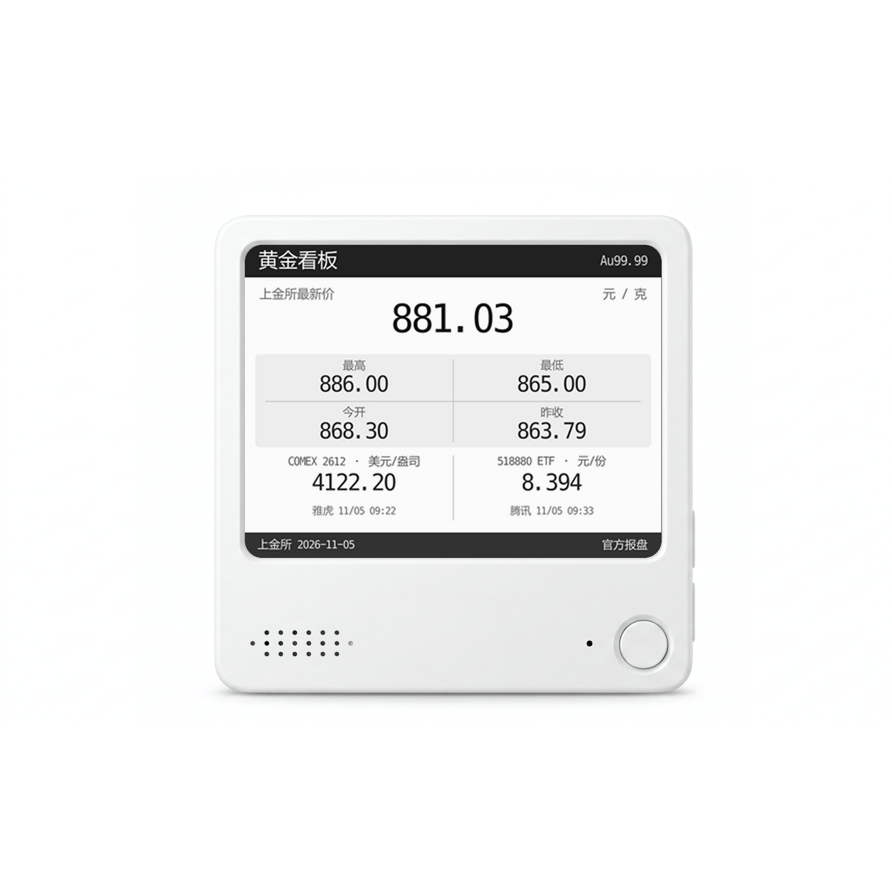
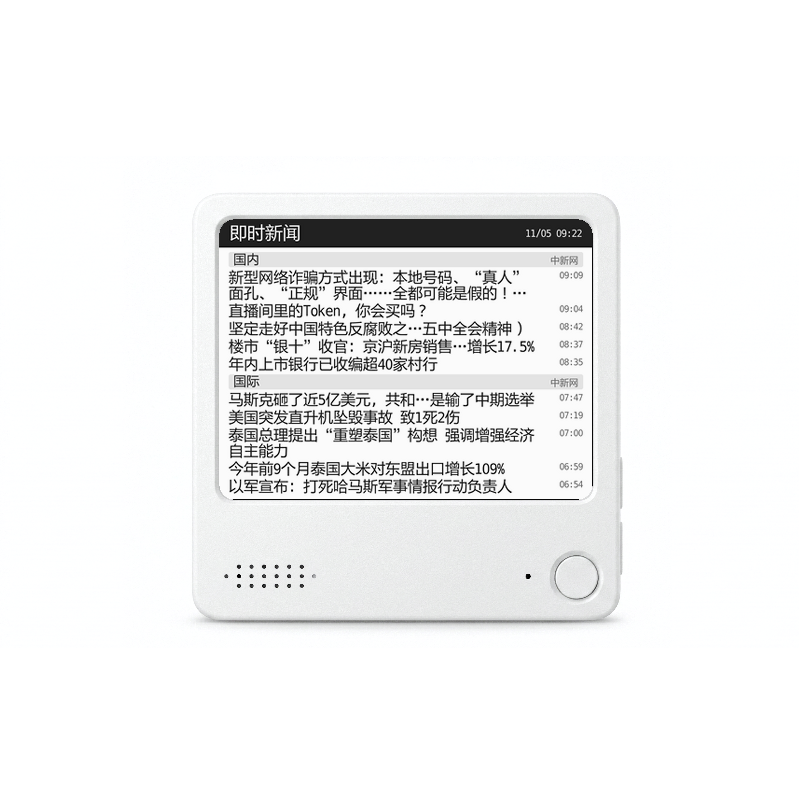
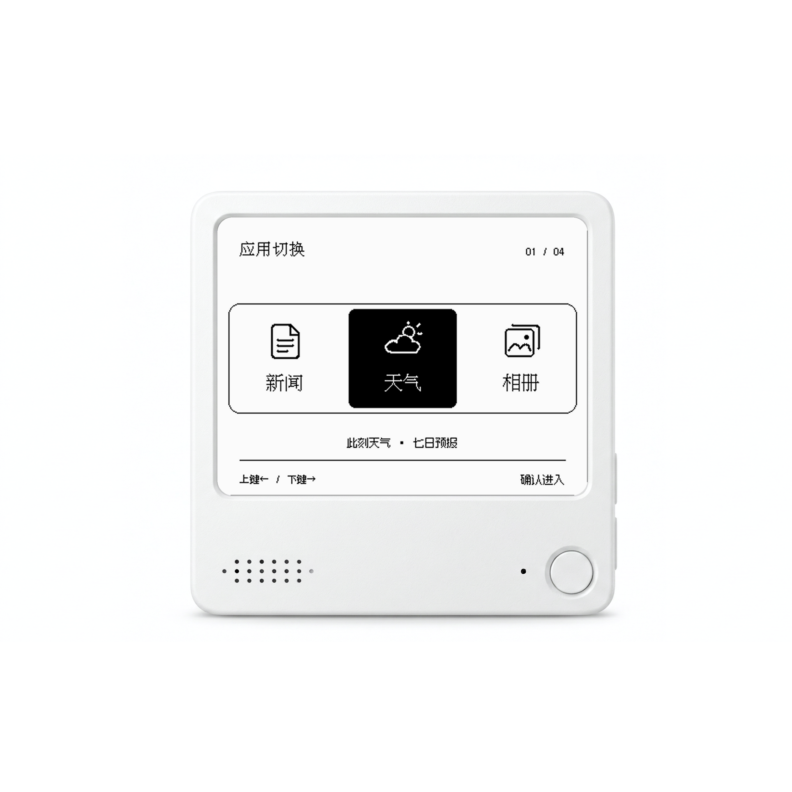

# NOTE4 局域网墨水屏仪表盘

面向 ZECTRIX NOTE4 的开源本地应用，通过官方 SDK 在 400 × 300 墨水屏上展示天气、相册、行情和新闻，并提供浏览器控制台。项目支持 Docker / NAS 部署及本机运行。设备地址、天气地点、照片和自选项目均可配置。

项目源码与部署说明：[note4-eink-dashboard](https://github.com/wuyinyuanye/note4-eink-dashboard)  
源码下载：[ZIP](https://github.com/wuyinyuanye/note4-eink-dashboard/archive/refs/heads/main.zip)  
许可证：[MIT](https://github.com/wuyinyuanye/note4-eink-dashboard/blob/main/LICENSE)

## 功能展示

以下为产品外观与应用画面合成的示意图，并非实机拍摄；时间、行情和新闻为截图时的示例，不代表实时数据。相册使用山水画示例。

### 天气与时钟

### NAS 相册

### 自选行情

### 板块行情

### 黄金看板

### 即时新闻

### 应用切换

实际显示效果、刷新方式和灰阶表现取决于设备固件；网络数据的可用性取决于来源。详情和部署条件请见项目 README。
